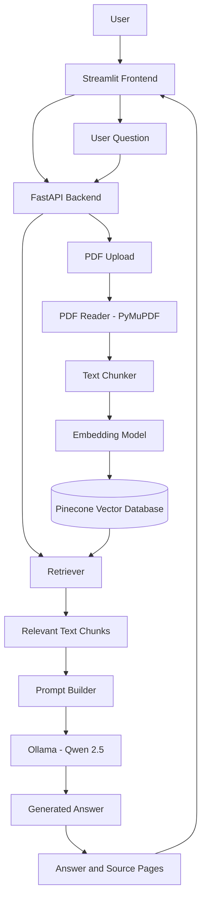

# RAG Document Chat

A Retrieval-Augmented Generation (RAG) application that allows users to upload PDF documents and ask questions about their contents using an AI language model.

The application retrieves relevant information from uploaded documents and generates answers grounded in the retrieved content.

## Features

- Upload PDF documents through a web interface.
- Extract text from PDF files.
- Split extracted text into smaller chunks.
- Generate vector embeddings using Sentence Transformers.
- Store and retrieve vectors using Pinecone.
- Ask questions about uploaded documents.
- Generate answers using a locally running Ollama model.
- Display source document and page information alongside answers.

## Technology Stack

| Component | Technology |
|---|---|
| Programming language | Python |
| Frontend | Streamlit |
| Backend API | FastAPI |
| PDF processing | PyMuPDF |
| Text chunking | Custom Python implementation |
| Embeddings | Sentence Transformers |
| Embedding model | all-MiniLM-L6-v2 |
| Vector database | Pinecone |
| LLM runtime | Ollama |
| Language model | Qwen 2.5 1.5B |
| HTTP communication | Requests |

## Architecture



## How It Works

### 1. Document Ingestion

1. The user uploads a PDF through Streamlit.
2. FastAPI receives the uploaded document.
3. PyMuPDF extracts text from the PDF.
4. The extracted text is divided into smaller chunks.
5. Sentence Transformers converts chunks into embeddings.
6. Embeddings and associated metadata are stored in Pinecone.

### 2. Question Answering

1. The user enters a question in the Streamlit chat interface.
2. FastAPI receives the question.
3. The embedding model and retriever identify relevant document chunks.
4. The prompt builder combines the question with the retrieved context.
5. Ollama generates an answer using Qwen 2.5.
6. The frontend displays the answer and source page information.

## Project Structure

```text
rag-document-chat/
│
├── backend/
│   ├── main.py
│   │
│   ├── services/
│   │   ├── __init__.py
│   │   ├── chunker.py
│   │   ├── embeddings.py
│   │   ├── llm.py
│   │   ├── pdf_reader.py
│   │   ├── prompt_builder.py
│   │   ├── retriever.py
│   │   └── vector_store.py
│   │
│   ├── scripts/
│   │   ├── check_index.py
│   │   ├── create_index.py
│   │   └── store_vectors.py
│   │
│   └── tests/
│       ├── test_embeddings.py
│       ├── test_llm.py
│       ├── test_pinecone_config.py
│       ├── test_prompt_builder.py
│       ├── test_rag.py
│       ├── test_reader.py
│       ├── test_retrieval.py
│       └── test_similarity.py
│
├── frontend/
│   └── app.py
│
├── .gitignore
├── requirements.txt
└── README.md
```

## Getting Started

### Prerequisites

- Python 3.11 or later
- Ollama installed
- Pinecone account and API key
- Git installed

### 1. Clone the repository

```bash
git clone https://github.com/vaigundaperumal/rag-document-chat.git

cd rag-document-chat
```

### 2. Create a virtual environment

```bash
python -m venv venv
```

Activate it on Windows:

```powershell
.\venv\Scripts\Activate.ps1
```

### 3. Install dependencies

```bash
pip install -r requirements.txt
```

### 4. Configure environment variables

Create a `.env` file inside the `backend` directory.

Add your Pinecone API key:

```env
PINECONE_API_KEY=your_pinecone_api_key
```

Make sure the Pinecone index is configured as expected by the backend.

**Never commit your actual `.env` file or API keys to GitHub.**

### 5. Start Ollama

Pull the required language model:

```bash
ollama pull qwen2.5:1.5b
```

Make sure Ollama is running locally.

### 6. Start the FastAPI backend

Open a terminal:

```powershell
cd backend

python -m uvicorn main:app --reload --host 127.0.0.1 --port 8000
```

FastAPI documentation:

http://127.0.0.1:8000/docs

### 7. Start the Streamlit frontend

Open another terminal from the project root:

```powershell
python -m streamlit run .\frontend\app.py
```

Frontend:

http://127.0.0.1:8501

## API Endpoints

| Method | Endpoint | Purpose |
|---|---|---|
| GET | `/` | Backend health check |
| POST | `/upload` | Upload and process PDF |
| GET | `/document/status` | Check active document |
| POST | `/chat` | Ask questions about the document |
| DELETE | `/document` | Remove the active document |

## Current Limitations

- The current backend uses in-memory active-document state.
- Multi-user document isolation and authentication are not implemented yet.
- Persistent conversation memory is planned.
- Production deployment and scaling are future improvements.

## Future Improvements

- Multi-user authentication and document management.
- Conversation history and multi-turn chat.
- Improved retrieval and reranking.
- Streaming AI responses.
- Agent-based natural-language workflows.
- Production deployment.

## License

License to be decided.
